# App screenshots

Use `$my-screenshots` to capture or update this set. The workflow is in
[my-screenshots](../.codex/skills/my-screenshots/SKILL.md). It finds the current
screens, controls, routes, and widget families before it selects capture states.
The list below records this capture only. It is not a fixed checklist for later
versions of the app.

## Capture record

Captured on 6 October 2026 from the current Debug build. Device: iPhone 17, iOS 26.5. Each PNG is a full-screen capture at 1206 × 2622 pixels. The logical screen size is 402 × 874 points at 3× scale. Images use light appearance and the 9:41 status-bar time.

The records are sample data. The simulator keeps the capture data and the Home Screen widget. No app source changes remain.

The source revision, source diff, locale, and time zone were not recorded in the
first run. The device and setup above are from that run's report. Do not infer
these values from the current checkout or use old simulator container paths.

## Update the set

1. Compare the current app structure with this capture record. Include new or
   changed screens and controls. Check current navigation and widget declarations
   even when a source diff is available.
2. Map each distinct visible state to an image or a stated limit. Combine states
   when the controls remain clear. Select a new starting set from that coverage;
   its size does not have to remain 12.
3. Save full-screen PNGs with names that identify the screen and state. Inspect
   contact sheets and unclear details at full size. Check the live Home Screen
   widget after data changes.
4. Replace this record and table for a full capture. For a partial update, mark
   reused images with their original date. Identify obsolete files before removing
   them. Record the source revision, relevant uncommitted changes, actual device
   and OS, appearance, locale, time zone, dimensions, fixture state, and limits.
5. Record file checks and visual checks separately. State which checks ran in the
   new capture. Keep earlier validation labelled as an earlier run.

The skill includes a helper for PNG integrity, dimensions, exact pixel duplicates,
and contact sheets. Use the Python path from `load_workspace_dependencies` if the
default Python does not include Pillow:

```sh
"$PYTHON" .codex/skills/my-screenshots/scripts/check_images.py screenshots \
  --sheets build/screenshot-capture/contact-sheets \
  --report build/screenshot-capture/images.json
```

Contact sheets and reports go in `build/`. The reference PNGs stay full-screen in
this folder. A file check cannot establish screen or control coverage.

## Start with these 12 images

These images cover the main screen layouts and controls. Use the other images for empty states, selected states, keyboards, pickers, confirmation dialogs, errors, and system screens.

- 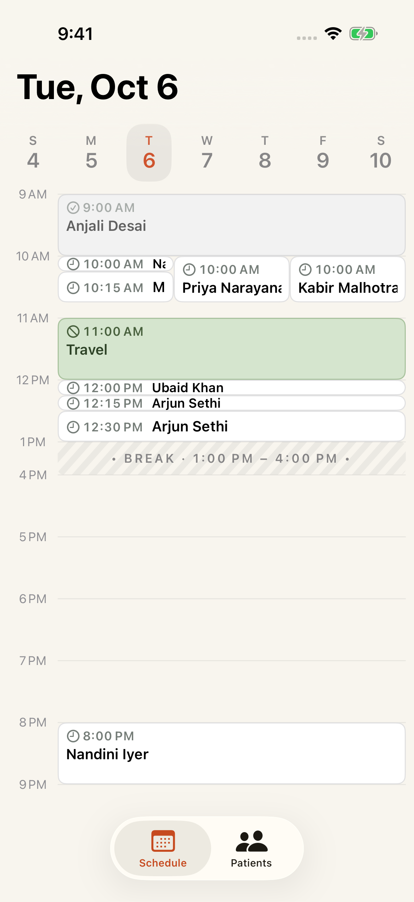
- 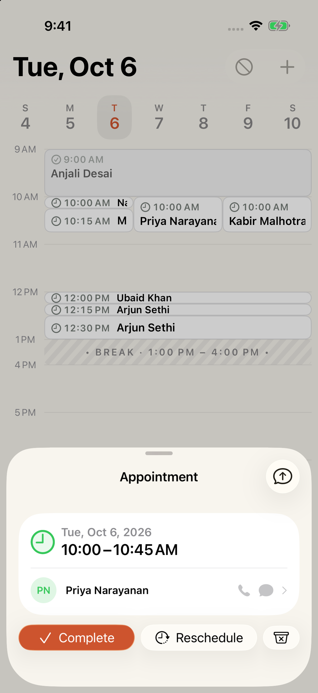
- 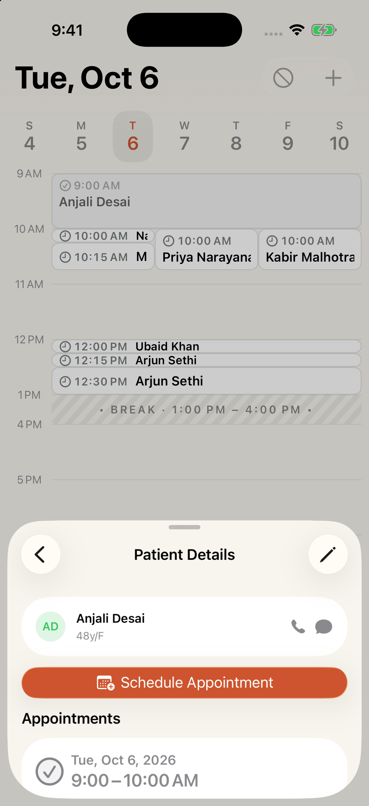
- 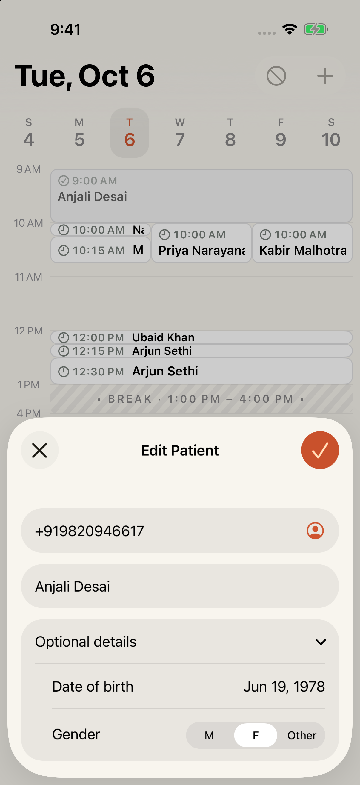
- 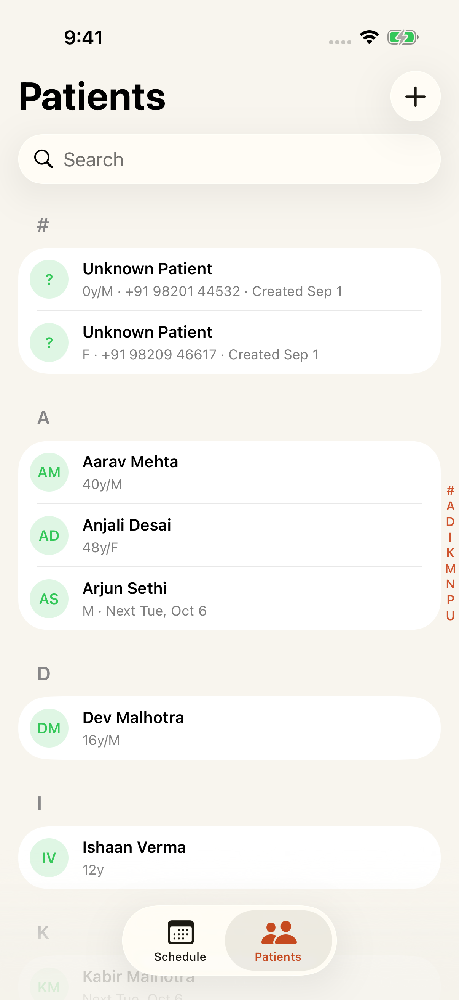
- 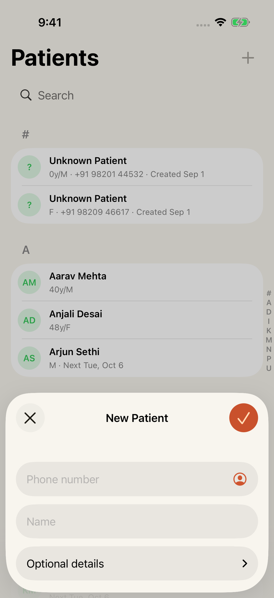
- 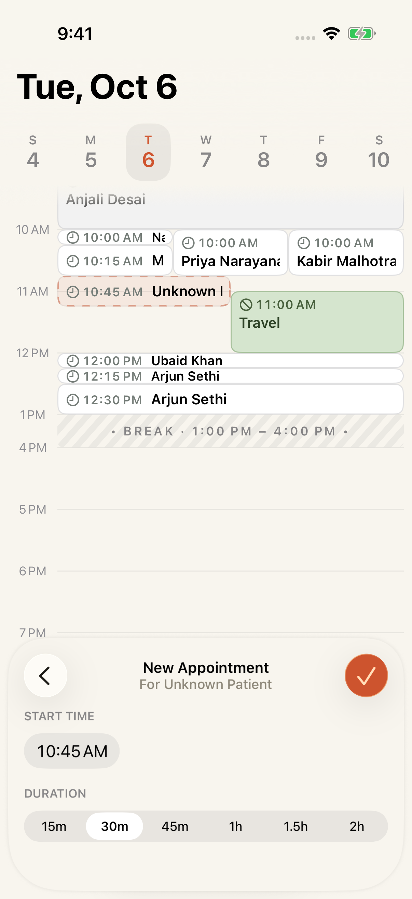
- 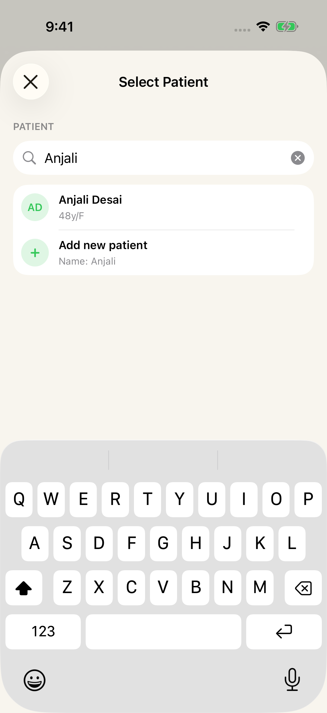
- 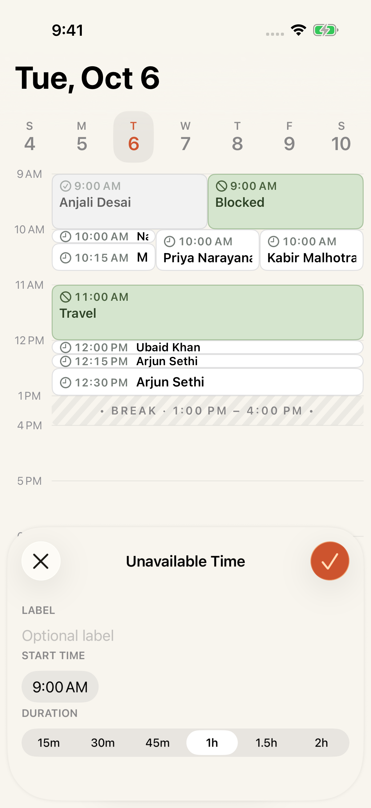
- 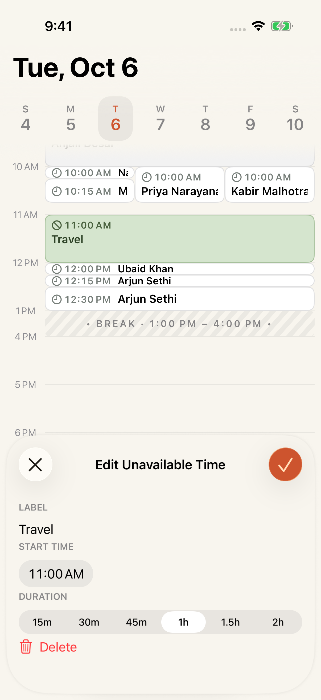
- 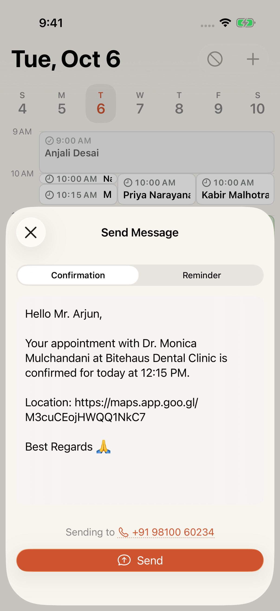
- 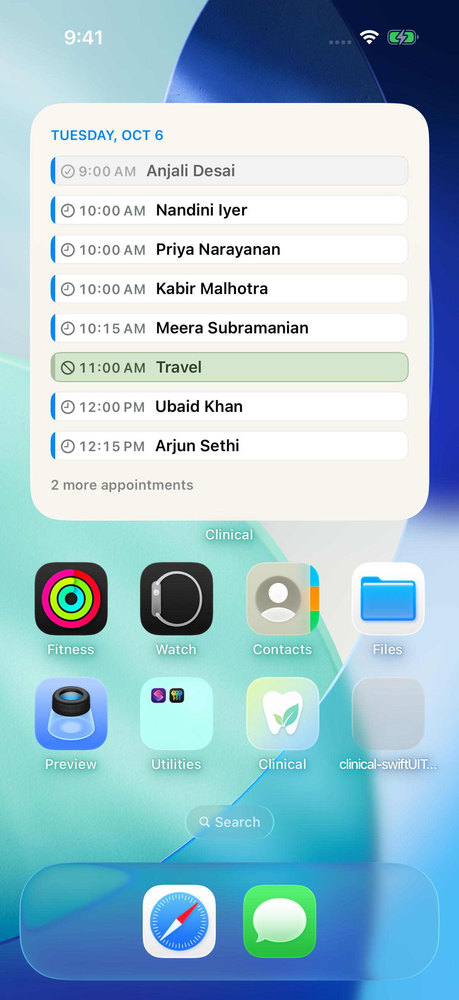

## Capture list

| File | Screen and state |
| --- | --- |
| [01-schedule-empty.png](01-schedule-empty.png) | Empty schedule; tomorrow selected; today remains marked. |
| [02-schedule-mixed.png](02-schedule-mixed.png) | Schedule with completed and scheduled appointments, overlaps, short cards, a break, and unavailable time. |
| [03-appointment-scheduled.png](03-appointment-scheduled.png) | Scheduled appointment; patient link; contact actions disabled; Complete, Reschedule, and Cancel controls. |
| [04-appointment-complete-confirmation.png](04-appointment-complete-confirmation.png) | Complete appointment confirmation. |
| [05-message-confirmation-no-phone.png](05-message-confirmation-no-phone.png) | Message confirmation; no phone number; Send disabled. |
| [06-message-reminder.png](06-message-reminder.png) | Message reminder selected. |
| [07-contact-picker.png](07-contact-picker.png) | System contact list and search. |
| [08-appointment-completed.png](08-appointment-completed.png) | Completed appointment; contact actions enabled; status actions absent. |
| [09-patient-details-history.png](09-patient-details-history.png) | Patient details opened from an appointment; Back and Edit controls; completed appointment history. |
| [10-patient-edit-collapsed.png](10-patient-edit-collapsed.png) | Edit Patient; filled fields; optional details closed. |
| [11-patient-edit-expanded.png](11-patient-edit-expanded.png) | Edit Patient; optional details open; date of birth and gender selected. |
| [12-patient-date-of-birth-picker.png](12-patient-date-of-birth-picker.png) | Date-of-birth wheel picker; Cancel and Done. |
| [13-patients-grouped-list.png](13-patients-grouped-list.png) | Patients; search; letter groups; unknown patients; age, gender, phone, creation date, and next appointment states. |
| [14-patients-search-match.png](14-patients-search-match.png) | Patient search with a result; clear and close controls; search keyboard. |
| [15-patients-search-empty.png](15-patients-search-empty.png) | Patient search with no results. |
| [16-patient-new.png](16-patient-new.png) | New Patient; empty fields; optional details closed. |
| [17-patient-new-expanded.png](17-patient-new-expanded.png) | New Patient; optional details open; no date of birth or gender selected. |
| [18-patient-validation-error.png](18-patient-validation-error.png) | Patient validation error. |
| [19-patient-name-keyboard.png](19-patient-name-keyboard.png) | Patient name entry; text keyboard; optional details open. |
| [20-patient-discard-confirmation.png](20-patient-discard-confirmation.png) | Patient discard confirmation. |
| [21-patient-unknown-empty-history.png](21-patient-unknown-empty-history.png) | Unknown patient details; contact actions; empty appointment history. |
| [22-booking-known-patient.png](22-booking-known-patient.png) | New appointment for a known patient; start time; duration; appointment draft shown on the schedule. |
| [23-booking-time-picker.png](23-booking-time-picker.png) | Appointment time wheel popup. |
| [24-booking-patient-selection.png](24-booking-patient-selection.png) | Appointment patient selection; empty search; patient list; keyboard. |
| [25-booking-search-match-create.png](25-booking-search-match-create.png) | Appointment search with a match and the Add new patient control. |
| [26-booking-search-new-patient.png](26-booking-search-new-patient.png) | Appointment search with no match and the Add new patient control. |
| [27-booking-patient-creation.png](27-booking-patient-creation.png) | Patient creation from booking; name filled from search; nested sheet. |
| [28-booking-discard-confirmation.png](28-booking-discard-confirmation.png) | Appointment discard confirmation. |
| [29-unavailable-time-new.png](29-unavailable-time-new.png) | New unavailable time; empty label; time and duration; draft overlaps an appointment. |
| [30-unavailable-time-discard-confirmation.png](30-unavailable-time-discard-confirmation.png) | Unavailable-time discard confirmation; two-hour duration selected. |
| [31-unavailable-time-edit.png](31-unavailable-time-edit.png) | Edit unavailable time; filled label; Delete control. |
| [32-unavailable-time-delete-confirmation.png](32-unavailable-time-delete-confirmation.png) | Unavailable-time delete confirmation. |
| [33-appointment-cancel-confirmation.png](33-appointment-cancel-confirmation.png) | Cancel appointment confirmation. |
| [34-appointment-reschedule.png](34-appointment-reschedule.png) | Edit appointment; patient subtitle; duration selected; draft on the schedule. |
| [35-message-valid-recipient.png](35-message-valid-recipient.png) | Message with a valid patient phone number; Send enabled. |
| [36-widget-gallery.png](36-widget-gallery.png) | System widget gallery; large widget preview and Add Widget. |
| [37-home-screen-widget.png](37-home-screen-widget.png) | Live Home Screen widget; completed and scheduled rows; unavailable time; overflow count. |
| [38-appointment-unavailable.png](38-appointment-unavailable.png) | Appointment Unavailable; missing record. |
| [39-unavailable-time-navigation-error.png](39-unavailable-time-navigation-error.png) | Unavailable-time navigation error; missing record. |
| [40-home-screen-widget-three-dates.png](40-home-screen-widget-three-dates.png) | Live Home Screen widget; today and the next two dates. |
| [41-home-screen-widget-empty.png](41-home-screen-widget-empty.png) | Live Home Screen widget; no appointments for the three dates. |
| [42-patient-history-expanded.png](42-patient-history-expanded.png) | Patient details with two scheduled appointments visible. |
| [43-patient-phone-keypad.png](43-patient-phone-keypad.png) | Patient phone entry; phone keypad. |
| [44-contacts-access-choice.png](44-contacts-access-choice.png) | System Contacts access choice. |
| [45-contacts-access-prompt.png](45-contacts-access-prompt.png) | System Contacts access prompt. |
| [46-message-simulator-error.png](46-message-simulator-error.png) | Message error shown when SMS is unavailable on the simulator. |
| [47-contact-phone-selection.png](47-contact-phone-selection.png) | System contact phone selection; contact has two phone numbers. |
| [48-message-selected-contact.png](48-message-selected-contact.png) | Message with a selected contact; notice that the phone number will be saved. |

## Capture limits

The simulator cannot display the SMS composer or open WhatsApp. Image 46 shows the simulator SMS error. Brief loading and saving states were not captured. Database write failures were not forced. Other device sizes and dark appearance were not captured.

In the first capture run, the app build and temporary UI capture test completed.
The temporary test file was removed. That run reported visual checks of all 48
PNGs, dimension and file integrity checks, and no exact duplicate PNG files.
These are prior results, not a new app build or capture.

On 6 October 2026, the new skill helper checked the existing 48 PNGs. All files
passed integrity checks at 1206 × 2622 pixels, with no exact pixel duplicates.
It generated four contact sheets. No new app build or screen capture was run
for this skill update.
